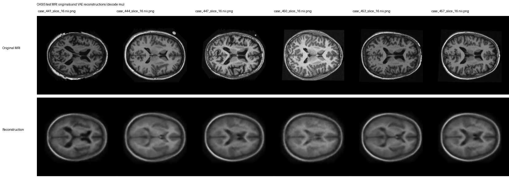
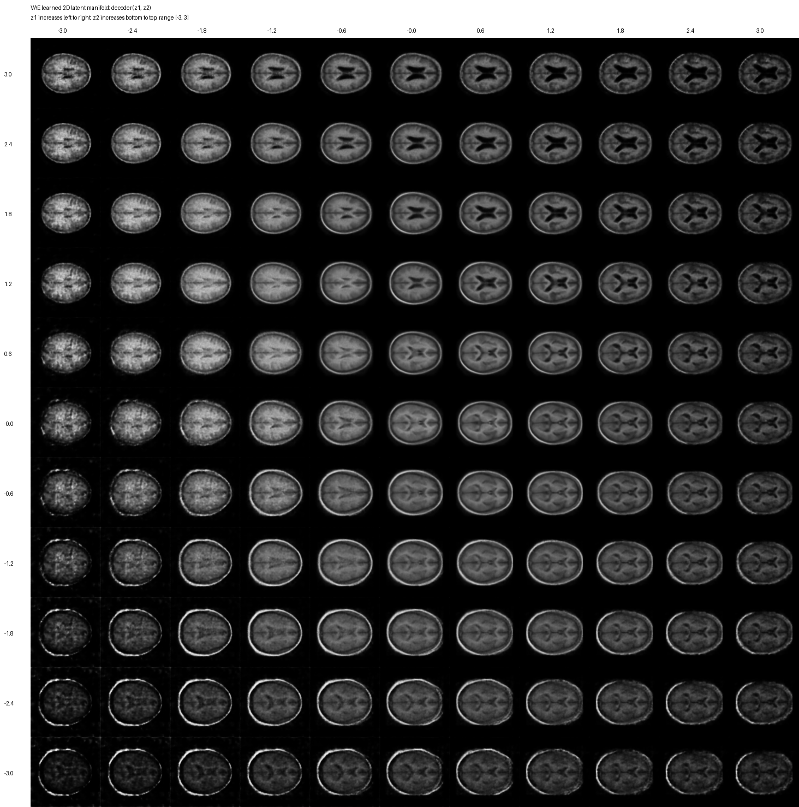
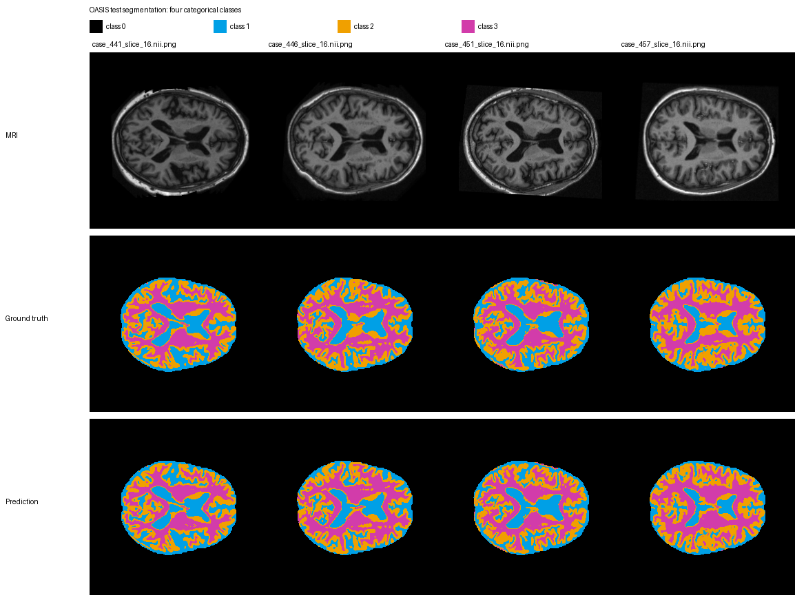
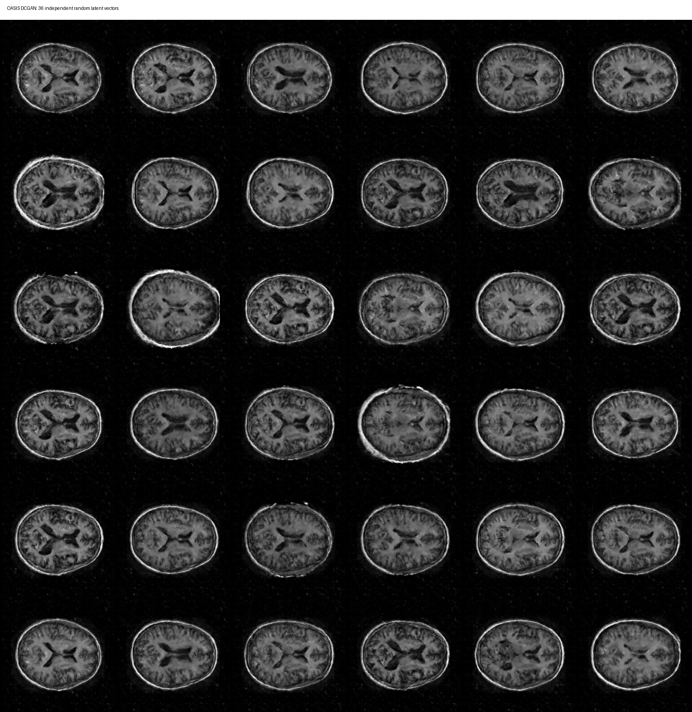
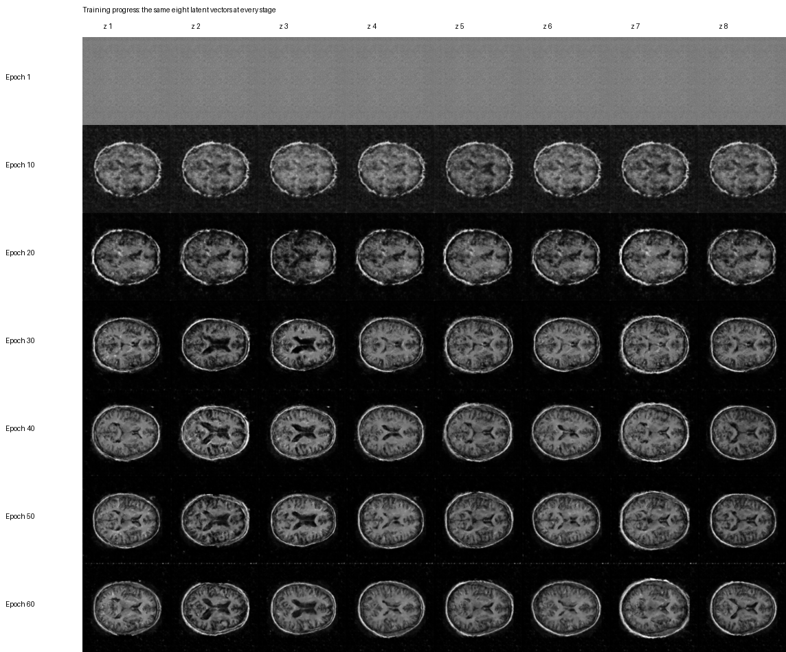
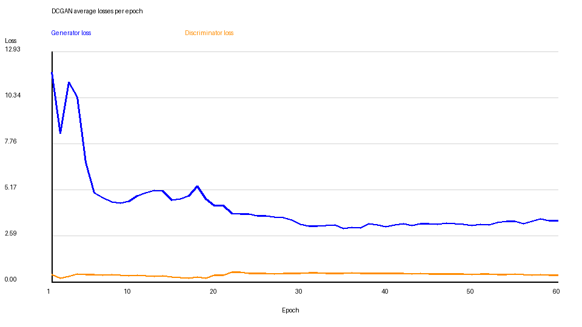

# COMP3710 Demonstration 2 - Part 4

## Overview

This project implements the HARD/full Part 4 recognition route:

1. Variational Autoencoder (VAE)
2. UNet categorical segmentation
3. Generative Adversarial Network (GAN)

All three models are manually implemented in PyTorch and use the supplied
preprocessed OASIS brain MRI dataset.

## Dataset

The course dataset is provided on Rangpur at `/home/groups/comp3710/OASIS/`:

- 256 x 256 grayscale MRI slices.
- PNG images with filenames ending in `.nii.png`.
- Supplied training, validation and test splits, used without repartitioning.
- Shared files are read directly from the course directory; the dataset is
  not stored in this repository.

VAE and UNet use the training and validation splits during training and the
test split for final results. GAN training uses only MRI slices 8-23 from
the training split. Segmentation masks are used only by UNet.

## Project Structure

```text
part4/
├── README.md
├── .gitignore
├── vae.py
├── unet.py
├── gan.py
└── results/
    ├── vae_reconstructions.png
    ├── vae_manifold.png
    ├── unet_segmentation.png
    ├── gan_samples.png
    ├── gan_progress.png
    └── gan_losses.png
```

Run the commands below from `~/COMP3710/lab2/part4` in a suitable GPU session
on Rangpur. Output paths are resolved relative to each script.

## Task 1 - Variational Autoencoder

`vae.py` uses a convolutional encoder to downsample a grayscale MRI and
produce `mu` (the posterior mean) and `logvar` (the logarithm of its variance).
Both have two components because the latent dimension is 2.

The explicit reparameterisation trick samples
`z = mu + exp(0.5 * logvar) * epsilon`, where `epsilon` is standard normal
noise. This allows gradients to flow through the sampled latent vector `z`
into the encoder. A convolutional decoder reconstructs the MRI, with a
final sigmoid matching input intensities in `[0, 1]`.

Training combines summed pixel squared reconstruction error with KL
divergence to the standard normal prior, averaged over the batch. The
reconstruction term encourages image fidelity; KL regularises the latent
distribution. The two-dimensional latent space allows direct manifold
visualisation by decoding a grid of coordinates, without dimensionality
reduction.

Training and figure generation:

```bash
python -B vae.py
```

The reconstruction figure compares test MRIs with reconstructions obtained
by decoding their posterior means. The rows allow comparison of original
structures and reconstructed detail.



The manifold figure decodes an 11 x 11 grid over `[-3, 3]` on each latent
axis, showing how generated appearance varies with the two coordinates.



## Task 2 - UNet Segmentation

`unet.py` performs categorical semantic segmentation: every MRI pixel is
assigned one of four mutually exclusive classes. Input shape is
`[B, 1, 256, 256]`; output logits have shape `[B, 4, 256, 256]`.

Convolution blocks and pooling form the encoder, a bottleneck processes
features at the lowest resolution, and the decoder upsamples them. Skip
connections join matching encoder and decoder features to retain spatial
detail for localisation. A final 1 x 1 convolution produces the four class
logits at each pixel. `argmax` over these logits gives the categorical mask.

Original mask intensities are validated and mapped to integer targets:

| Mask intensity | Class |
| --- | --- |
| 0 | class 0 |
| 85 | class 1 |
| 170 | class 2 |
| 255 | class 3 |

The anatomical meanings of these classes were not established, so no
anatomical names are assigned.

Training combines `CrossEntropyLoss` on raw logits (no preceding softmax)
with multiclass soft Dice loss. The Dice term compares softmax probabilities
with one-hot targets and gives each class equal weight.

For each class, Dice Similarity Coefficient (DSC) is
`2 * intersection / (predicted pixels + target pixels)`, using counts
accumulated over the entire evaluated split. Checkpoint selection maximises
the **minimum validation DSC** across the four classes, so a high mean
cannot hide a weak class. Final testing loads this best checkpoint.

Verified TEST results:

| Measure | DSC |
| --- | ---: |
| Class 0 | 0.999320 |
| Class 1 | 0.962835 |
| Class 2 | 0.965061 |
| Class 3 | 0.979312 |
| Mean | 0.976632 |
| Minimum | 0.962835 |

All four test classes exceeded DSC 0.90.

Training:

```bash
python -B unet.py
```

Saved-model test inference:

```bash
python -B unet.py --eval-only
```

`--eval-only` loads `unet_best.pt`, performs test-set inference, prints
per-class, mean and minimum DSC, and saves the segmentation figure without
retraining.

The figure rows show MRI, ground-truth categorical segmentation and
predicted segmentation, using the same class colours for both masks.



## Task 3 - GAN

`gan.py` manually implements a DCGAN trained for **60 epochs** using OASIS
MRI slices **8 through 23 inclusive**, selected from training filenames.
The latent dimension is **128**.

The generator transforms random noise through `ConvTranspose2d` layers,
with BatchNorm and ReLU at intermediate stages. Its final Tanh produces
`[1, 256, 256]` images in `[-1, 1]`; real MRIs are scaled to the same range.
The discriminator uses strided `Conv2d` and LeakyReLU to produce one raw
logit per image. `BCEWithLogitsLoss` handles the sigmoid internally.

Separate Adam optimisers alternate adversarial updates:

- The discriminator learns from real MRI and detached generated images,
  using mild one-sided label smoothing: real target `0.9`, fake target `0.0`.
- The generator learns to make generated images be classified as real,
  using target `1.0`. Discriminator parameters are frozen during this update,
  while gradients flow through it to the generator.

Training:

```bash
python -B gan.py
```

Generate fresh samples from the saved model:

```bash
python -B gan.py --generate-only
```

`--generate-only` loads `gan_final.pt` and updates the sample grid using
fresh random latent vectors, without training or loading the dataset.

The final 6 x 6 grid uses **36 independent random latent vectors**, allowing
visual inspection of generated MRI appearance and diversity. Mode collapse
occurs when different latent inputs produce similar outputs. Diversity must
be assessed visually; losses alone do not confirm the absence of collapse.



The progress figure uses the **same eight latent vectors** at epochs 1,
10, 20, 30, 40, 50 and 60. Each row is a training stage and each column
follows one fixed latent vector.



The loss plot records average generator and discriminator losses per epoch
as training evidence. GAN losses need not decrease monotonically because
both adversarial networks are learning.



## Demonstration Commands

UNet saved-model inference on the test split:

```bash
python -B unet.py --eval-only
```

GAN generation of fresh random samples:

```bash
python -B gan.py --generate-only
```

The trained `unet_best.pt` and `gan_final.pt` checkpoints remain beside the
scripts on Rangpur for the live demonstration and are excluded from GitHub.
The VAE results are shown in the saved reconstruction and manifold figures;
`vae.py` has no evaluation-only mode.

`.gitignore` excludes checkpoints, Slurm `.out` files, Python bytecode and
common local temporary files. All six result PNGs remain tracked as
assessment evidence.

## Software

- Python
- PyTorch
- NumPy
- Pillow

GPU training was performed on the UQ Rangpur cluster.
